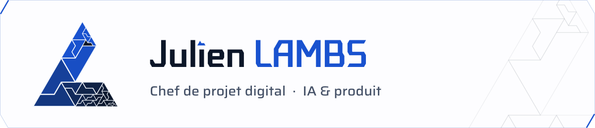

<picture>
  <source media="(prefers-color-scheme: dark)" srcset="assets/banner-dark.svg">
  
</picture>

Chef de projet digital, 7 ans d'expérience en agence, chez l'annonceur et en conseil. Je cadre, construis et déploie des projets IA en production, à la croisée de la tech, du produit et des utilisateurs.

Je conçois aussi mes propres outils, en pilotant des agents IA, et je les héberge sur mon serveur personnel.

### Projets

| Projet | En bref | Stack |
|---|---|---|
| **[Ariane](https://julienlambs.dev/ariane.html)** · [code](https://github.com/julienlambs/Ariane) | Assistant vocal Android qui range ce qu'on lui confie et le rend au bon moment, sans jamais afficher de liste. Évalué par 702 tests sans réseau et un rejeu de 58 scénarios avec le vrai modèle (58 sur 58) | FastAPI, API Claude, React, Capacitor |
| **[Radar](https://julienlambs.dev/radar.html)** | Recherche d'emploi automatisée, du sourcing au tableau de suivi | n8n, API Claude, FastAPI |
| **[MyAI](https://julienlambs.dev/myai.html)** · [code](https://github.com/julienlambs/MyAI) | Interface web pour piloter un agent IA 100 % local depuis un navigateur | React, FastAPI, llama.cpp |
| **[Pulse](https://julienlambs.dev/pulse.html)** | Agrégateur de veille tech pensé pour le mobile | React, FastAPI, SQLite, Docker |

### Méthode

Comment je mène un projet complexe avec des agents IA ([détail sur le site](https://julienlambs.dev/#methode)) :

- **Un ticket, une branche, une revue** : chaque idée devient un ticket, chaque changement passe par une branche et une relecture, que le code vienne d'un humain ou d'un agent.
- **Des règles tenues par la CI** : à chaque demande de fusion, les tests tournent, une IA relit le code et un script vérifie les règles du projet. Un agent peut oublier une règle, la CI ne l'oublie pas.
- **Codé n'est pas validé** : un développement reste « à valider » tant qu'il n'a pas été testé en conditions réelles. Un produit qui embarque un modèle s'évalue comme un logiciel, coût et latence mesurés.
- **Une mémoire partagée** : règles, état du projet et journal daté, lus par les humains comme par les agents.
- **Le bon modèle pour chaque tâche** : un petit modèle pour chercher, un intermédiaire pour coder, le plus puissant pour l'architecture, un modèle local quand les données ne doivent pas sortir.
- **Savoir où ne pas en mettre** : sur Ariane, le modèle comprend la phrase et le code garantit tout le reste.

### Contact

Basé en Île-de-France, ouvert à un CDI sur place ou en remote.

[julienlambs.dev](https://julienlambs.dev) · [LinkedIn](https://www.linkedin.com/in/julien-lambs) · [CV](https://julienlambs.dev/CV_JULIEN_LAMBS_2026.pdf)
